# 📊 Візуальні діаграми проєкту

## Структура безпеки криптографічної конфігурації

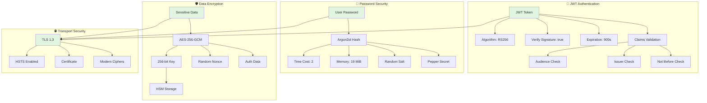

---

## Порівняння рівнів безпеки конфігурацій

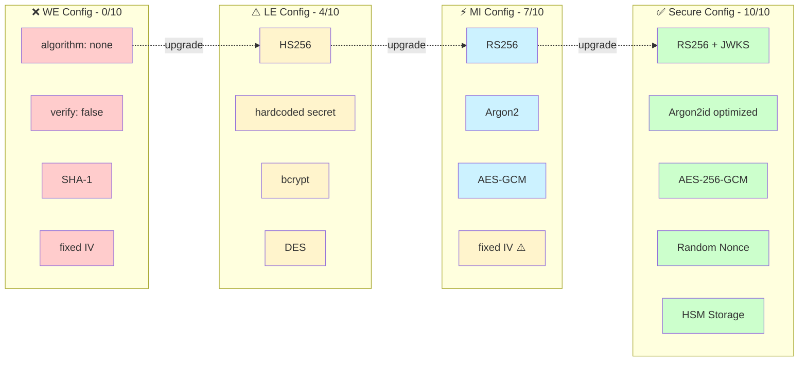

---

## Життєвий цикл JWT токену (Безпечний)

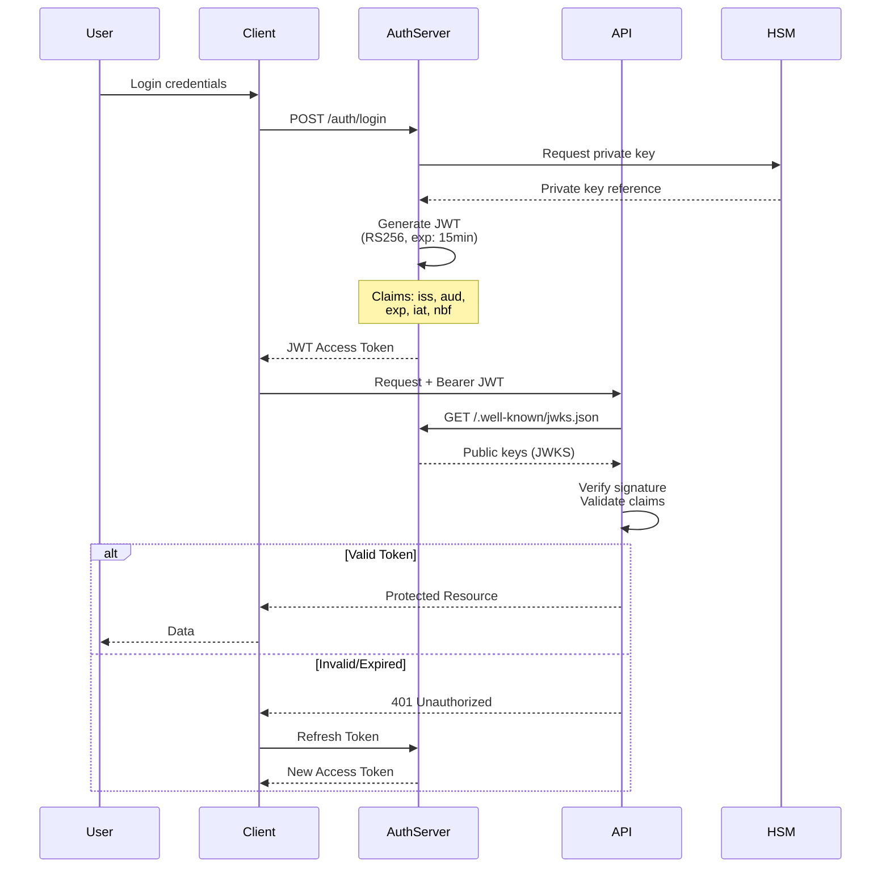

---

## Процес хешування пароля (Argon2id)

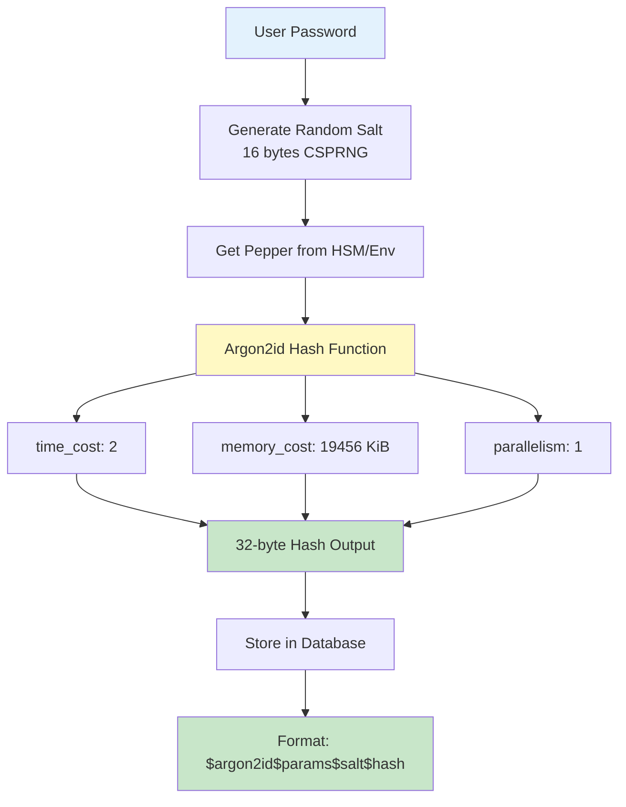

---

## Процес шифрування даних (AES-256-GCM)

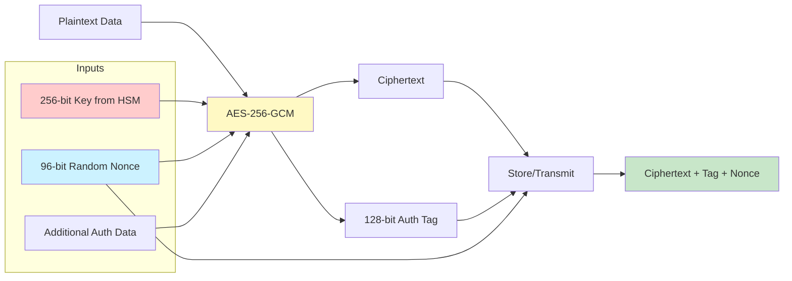

---

## Архітектура управління ключами

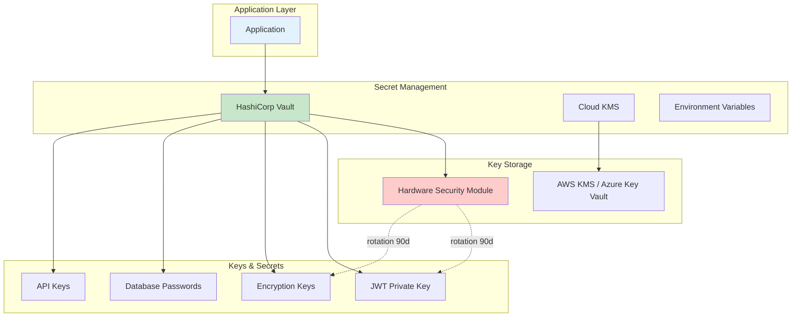

---

## Матриця ризиків конфігурацій

```mermaid
quadrantChart
    title Security Risk Matrix
    x-axis Low Impact --> High Impact
    y-axis Low Probability --> High Probability
    quadrant-1 Critical (Fix Now)
    quadrant-2 High Risk
    quadrant-3 Monitor
    quadrant-4 Medium Risk
    
    WE - algorithm none: [0.9, 0.9]
    WE - no verify: [0.85, 0.85]
    LE - hardcoded secret: [0.6, 0.7]
    LE - DES encryption: [0.7, 0.6]
    MI - fixed IV GCM: [0.8, 0.7]
    MI - low Argon2 params: [0.4, 0.5]
    Secure Config: [0.1, 0.1]
```

---

## Timeline покращення безпеки

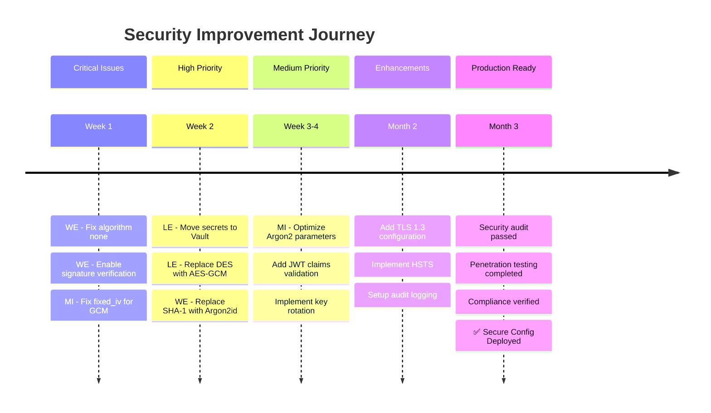

---

## Compliance відповідність

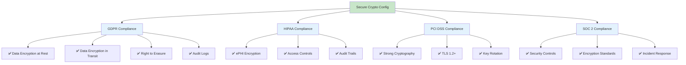

---

## Процес ротації ключів

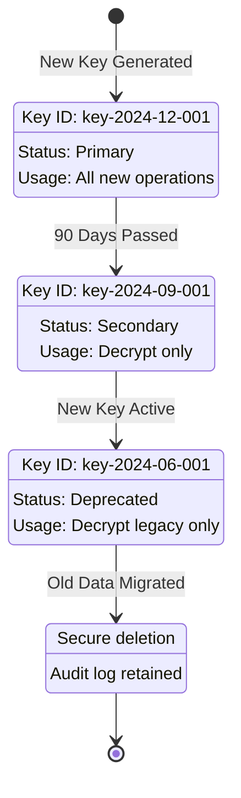

---

## Attack Surface зменшення

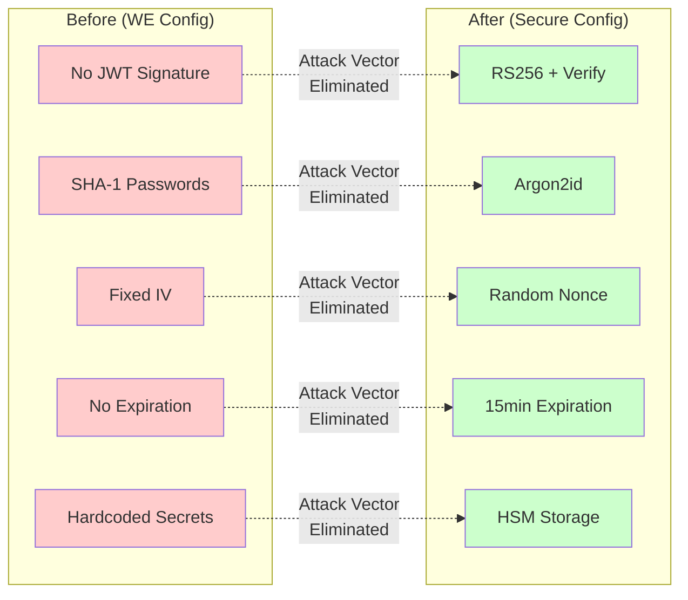

---

## Оцінка безпеки (0-10 шкала)

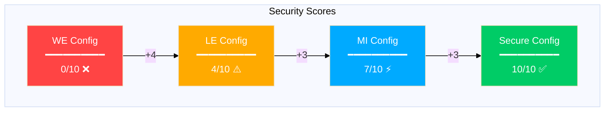

---

## Використання діаграм

### Для презентацій:
- Копіюйте Mermaid код
- Вставте у Markdown файл
- GitHub/GitLab автоматично відобразить діаграми

### Для документації:
- Використовуйте у README
- Додайте у wiki проєкту
- Включіть у технічну документацію

### Для навчання:
- Візуалізація процесів
- Пояснення архітектури
- Демонстрація покращень

---

## Інструменти для роботи з діаграмами

- **GitHub/GitLab:** Вбудована підтримка Mermaid
- **Mermaid Live Editor:** https://mermaid.live
- **VS Code:** Mermaid Preview Extension
- **Confluence:** Mermaid Macro
- **Notion:** Mermaid blocks

---

**Всі діаграми створені за допомогою Mermaid.js**  
**Легко редагувати та підтримувати! 📊**
